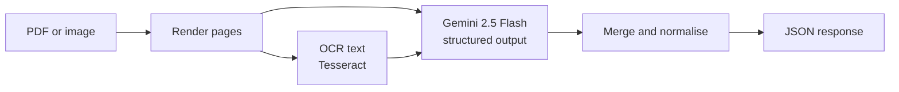

# Medical Bill Extractor

A FastAPI service that reads hospital bills and invoices (PDFs or images) and returns every line item as structured JSON: item name, quantity, rate and amount, page by page.

Built originally for the Bajaj Finserv Datathon (ranked 44th), now being redesigned around one principle: **the model reads, deterministic code checks.** Gemini turns page images into rows; code verifies every value against the page text and the bill's own arithmetic, and flags anything it can't confirm.


## How it works



1. PDFs are rendered to page images (pdf2image); single images are cleaned up with Pillow.
2. Tesseract OCR text is sent alongside each page image as extra context.
3. Gemini extracts the rows through LangChain structured output, inside a small LangGraph pipeline, with retries and model fallbacks on quota errors.
4. The API normalises the result into a fixed response schema.

Every request is traced in LangSmith (see [Observability](#observability)).

## Quick start

Requirements: Python 3.10, plus `poppler` and `tesseract` (`brew install poppler tesseract`, or `apt-get install poppler-utils tesseract-ocr`).

```bash
python -m venv .venv && source .venv/bin/activate
pip install -r requirements.txt

cp .env.example .env    # or create .env by hand, see Configuration
uvicorn app.main:app --reload --port 8000
```

Open http://127.0.0.1:8000/docs for the interactive API.

With Docker:

```bash
docker build -t bill-extractor .
docker run -p 10000:10000 --env-file .env bill-extractor
```

## API

| Method | Path | Input |
|---|---|---|
| `POST` | `/extract-from-file` | multipart upload, field `file` (PDF, PNG or JPEG, up to 20 MB) |
| `POST` | `/extract-bill-data` | JSON `{"document": "https://.../bill.pdf"}` |
| `GET` | `/health` | — |

```bash
curl -X POST http://127.0.0.1:8000/extract-from-file -F "file=@bill.pdf"
```

Response:

```json
{
  "is_success": true,
  "token_usage": {"total_tokens": 0, "input_tokens": 0, "output_tokens": 0},
  "data": {
    "pagewise_line_items": [
      {
        "page_no": "1",
        "page_type": "Bill Detail",
        "bill_items": [
          {"item_name": "CBC", "item_amount": 240.0, "item_rate": 240.0, "item_quantity": 1.0}
        ]
      }
    ],
    "total_item_count": 1
  },
  "error": null
}
```

Extraction failures return HTTP 200 with `is_success: false` and an `error` message. The schema is fixed by the original Datathon contract.

## Configuration

Set in `.env` or the environment.

| Variable | Required | Default | Purpose |
|---|---|---|---|
| `GOOGLE_API_KEY` | yes | — | Gemini API key |
| `GEMINI_MODEL` | | `gemini-2.5-flash` | Main model |
| `GEMINI_MODEL_FALLBACKS` | | `gemini-flash-latest,gemini-2.0-flash` | Tried in order on quota errors |
| `BATCH_SIZE` | | `2` | Pages per model call |
| `PDF_DPI` | | `200` | Page render resolution |
| `MAX_RETRIES` | | `10` | Retries per model |
| `USE_MOCK_MODE` | | `false` | Return sample data without calling Gemini |
| `LANGSMITH_TRACING` | | — | `true` to send traces to LangSmith |
| `LANGSMITH_API_KEY` | for tracing | — | LangSmith key |
| `LANGSMITH_ENDPOINT` | | `https://api.smith.langchain.com` | LangSmith API |
| `LANGSMITH_AGENT_ID` | for tracing | — | `medical-bill-extractor` |
| `LANGSMITH_AGENT_ENVIRONMENT` | for tracing | — | `local`, `development`, `staging` or `production` |

Don't set `LANGSMITH_PROJECT` together with the agent variables; LangSmith then records nothing.

## Observability

Each request produces one LangSmith trace: the API call, page rendering, OCR, every Gemini call (model, retries, tokens, latency) and the extracted rows.

Bills contain patient data, so all tracing goes through [`app/tracing.py`](app/tracing.py), which removes page images, file bytes and raw OCR text before anything leaves the machine. File names and full document URLs are never traced. If LangSmith is unreachable, requests run normally.

## Evaluation

The `eval/` harness compares the pipeline's output with a hand-made answer key and reports line recall, line precision, amount accuracy and bill-total matches. Lines are matched by page, exact amount and fuzzy item name. The answer key and sample bills stay outside this repository because they contain patient data.

```bash
python -m eval.run_baseline --out eval/outputs/my-run          # run the pipeline on the samples
python -m eval.run_eval --outputs eval/outputs/my-run --format legacy --label my-run --compare
```

## Tests

```bash
pytest -q -m "not integration"    # offline, no API calls
pytest -q                          # also calls Gemini (needs a key and quota)
```

## Project layout

```text
app/
  main.py          API routes and response normalisation
  extractor.py     extraction pipeline (render, OCR, Gemini, merge)
  tracing.py       LangSmith tracing and data masking
  schemas.py       response models
eval/              answer-key scorer, baseline runner, dataset converters
tests/             API, pipeline, tracing and scorer tests
docs/context/      design docs: overview, architecture, low-level design, progress
```

## Roadmap

The redesign is specified in [`docs/context/`](docs/context/) and tracked in [`progress-tracker.md`](docs/context/progress-tracker.md):

- every printed line returned with a role (billable, summary or breakdown), so totals never double-count;
- per-line source locations and confidence, checked against OCR text and the bill's own totals;
- async jobs for long bills, and a review page for flagged documents;
- a public demo on Hugging Face Spaces.
