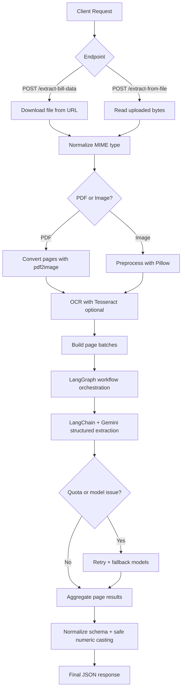
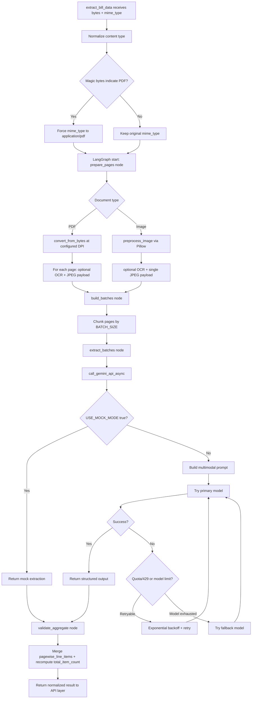

# Automated Bill Extraction System

Production-ready FastAPI service that extracts structured line items from bill images and PDFs using a hybrid OCR + LLM pipeline.


## Purpose

Medical bills and invoices are semi-structured and vary across providers. This service accepts a bill document URL or uploaded file, extracts itemized lines, and returns normalized JSON in a fixed response schema.

## End-to-End Execution Flow



## Internal Extraction Workflow (Detailed)



## Technology Map (Where Each Tech Is Used)

| Stage              | Technology                                    | Why it is used                                              |
| ------------------ | --------------------------------------------- | ----------------------------------------------------------- |
| API layer          | FastAPI, Pydantic                             | Request validation, response schema, async endpoints        |
| Networking         | requests                                      | Download remote documents from URL input                    |
| File understanding | MIME normalization + PDF magic-byte detection | Reliable type detection even for incorrect headers          |
| PDF handling       | pdf2image                                     | Convert PDF pages to images for multimodal extraction       |
| Image enhancement  | Pillow                                        | Improve image quality before OCR/model call                 |
| OCR context        | pytesseract                                   | Extra textual signal for noisy or low-quality pages         |
| Orchestration      | LangGraph                                     | Stepwise pipeline: prepare -> batch -> extract -> aggregate |
| LLM integration    | LangChain + ChatGoogleGenerativeAI            | Structured extraction via Gemini with typed output          |
| Model resilience   | Retry + fallback model list                   | Better behavior under rate limit/quota pressure             |
| Packaging          | Docker, render.yaml                           | Deployable service for cloud runtime                        |
| Quality            | pytest                                        | Unit and API behavior validation                            |

## API Overview

### 1) Health

- Method: GET
- Path: /health
- Purpose: Liveness/version check

Example:

```bash
curl http://127.0.0.1:8000/health
```

### 2) Extract from URL

- Method: POST
- Path: /extract-bill-data
- Input: JSON with document URL

Request:

```json
{
  "document": "https://example.com/bill.pdf"
}
```

Example:

```bash
curl -X POST http://127.0.0.1:8000/extract-bill-data \
  -H "Content-Type: application/json" \
  -d '{"document":"https://example.com/bill.pdf"}'
```

### 3) Extract from File Upload

- Method: POST
- Path: /extract-from-file
- Input: multipart/form-data with file

Example:

```bash
curl -X POST http://127.0.0.1:8000/extract-from-file \
  -F "file=@/absolute/path/to/bill.pdf"
```

### Response Shape

```json
{
  "is_success": true,
  "token_usage": {
    "total_tokens": 0,
    "input_tokens": 0,
    "output_tokens": 0
  },
  "data": {
    "pagewise_line_items": [
      {
        "page_no": "1",
        "page_type": "Bill Detail",
        "bill_items": [
          {
            "item_name": "Sample",
            "item_amount": 100.0,
            "item_rate": 100.0,
            "item_quantity": 1.0
          }
        ]
      }
    ],
    "total_item_count": 1
  },
  "error": null
}
```

## Setup and Run

### 1) Install dependencies

```bash
pip install -r requirements.txt
```

System dependencies required for PDF/OCR:

- poppler-utils
- tesseract-ocr

### 2) Configure environment

Create .env in the project root:

```env
GOOGLE_API_KEY=your_google_api_key
GEMINI_MODEL=gemini-2.5-flash
GEMINI_MODEL_FALLBACKS=gemini-flash-latest,gemini-2.0-flash
MAX_RETRIES=10
BATCH_SIZE=2
PDF_DPI=200
USE_MOCK_MODE=false
```

### 3) Start the API

```bash
python -m uvicorn app.main:app --host 127.0.0.1 --port 8000 --reload
```

Swagger UI:

- http://127.0.0.1:8000/docs

## Project Structure

```text
.
|-- app/
|   |-- main.py          # FastAPI routes, request/response normalization
|   |-- extractor.py     # Hybrid extraction pipeline + LangGraph workflow
|   `-- schemas.py       # Pydantic output models
|-- tests/
|   |-- test_api.py      # Endpoint and validation tests
|   |-- test_unit.py     # Utility and workflow behavior tests
|   `-- test_models.py   # Integration smoke tests for model access
|-- Dockerfile
|-- render.yaml
|-- requirements.txt
|-- pytest.ini
`-- README.md
```

## Testing

```bash
# Fast local signal (no external model dependency)
pytest -q -m "not integration"

# Full suite
pytest -q
```

## Deployment Notes

- The service is containerized via Dockerfile.
- render.yaml is included for Render deployment.
- If model quota is exhausted, extraction can fail unless USE_MOCK_MODE is set to true for demo/testing.

## Achievement

Rank 44 in Bajaj Finserv Datathon.
