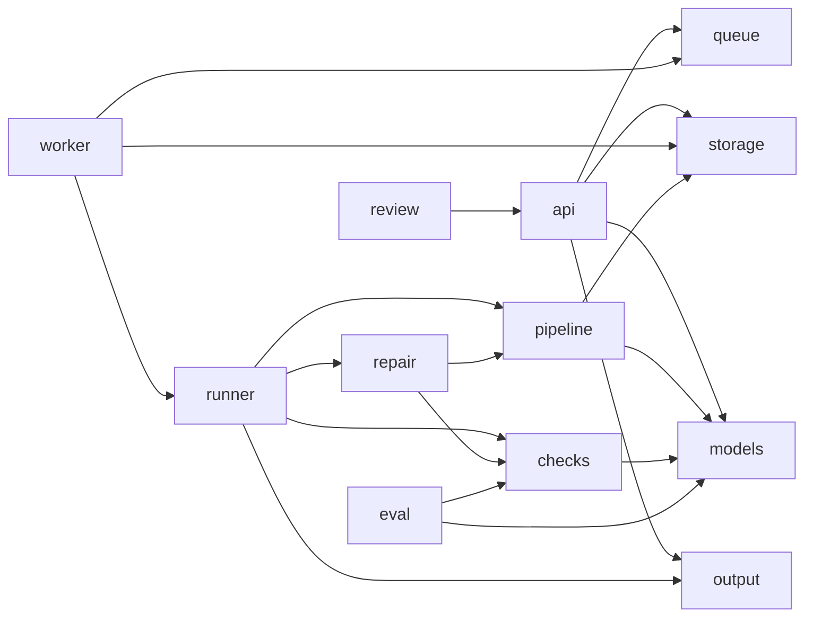
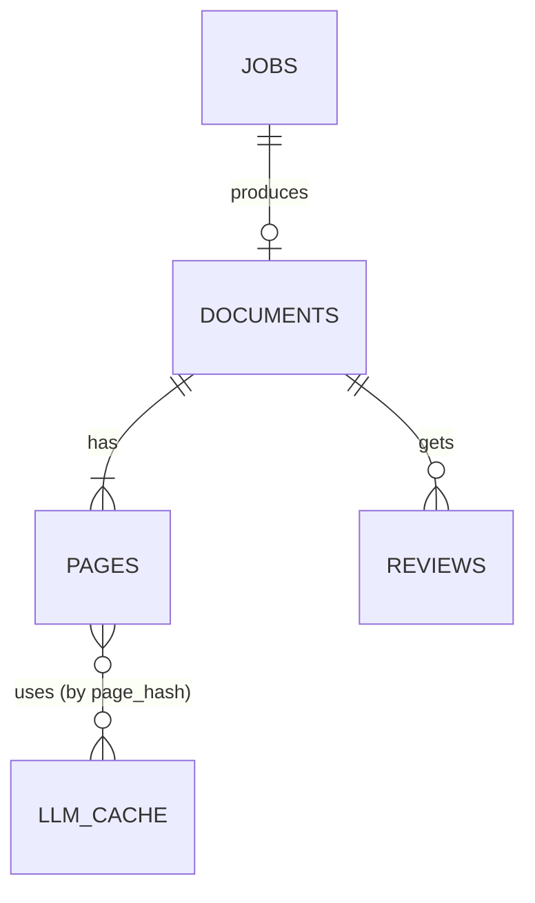
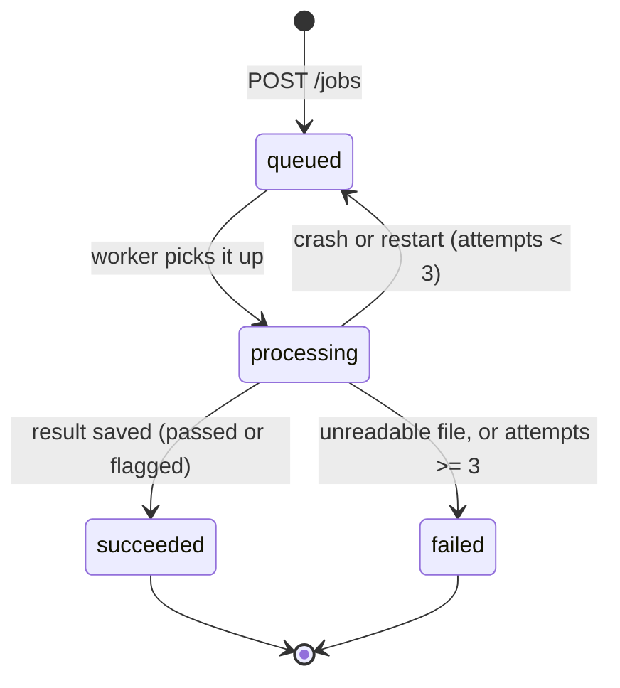

# Low-Level Design

Status: draft, 2026-11-20. This is the detailed design behind `architecture.md` (the high-level design) and `project-overview.md` (what to build). It covers module layout, data models, storage schema, API contracts, how each stage works, and the evaluation harness. Interfaces are described as data shapes and responsibilities, not code.

## 0. Owner-confirmed proposals

Approved by the owner on 2026-11-20 when M0 started. Marked **(P)** below; thresholds are tuned in M1–M3:

- **P1:** PDF text-layer quality check (§7.2).
- **P2:** OCR near match counts as `weakly_grounded` (§8.2).
- **P3:** Name grounding on the same row (§8.3).
- **P4:** Coverage check for unclaimed amounts (§8.7).
- **P5:** Serial-number continuity (§8.8).
- **P6:** Injected-error tests of the checks (§11.4).
- **P7:** Development/test split and the upload cycle (§11.1).

---

## 1. Module layout

```
medical-bill-extractor/
├─ app/
│  ├─ api/          routes_jobs.py, routes_review.py, api_models.py
│  ├─ core/         settings.py (all config), logging.py (no PII in logs)
│  ├─ models/       document.py (output contract), internal.py (working models),
│  │                llm_io.py (Gemini input/output schemas), enums.py
│  ├─ storage/      db.py (SQLite access), files.py (data folder), cache.py
│  ├─ queue/        job_queue.py (interface + SQLite implementation)
│  ├─ worker/       worker.py (polling loop), runner.py (runs stages for one document)
│  ├─ pipeline/     ingest.py, rotation.py, page_text.py, ocr.py, classify.py,
│  │                extract.py, llm_client.py (Gemini, rate limit, cache), prompts/ (versioned text)
│  ├─ checks/       numbers.py, grounding.py, columns.py, arithmetic.py, roles.py,
│  │                coverage.py, serials.py, confidence.py
│  ├─ repair/       repair.py, second_read.py
│  ├─ output/       views.py (core and full views)
│  └─ review/       templates/ (Jinja2), static/ (HTMX, CSS)
├─ eval/            migrate_answer_key.py, matcher.py, metrics.py, mutations.py,
│                   run_eval.py, splits.yaml, baselines/
├─ tests/           mirrors app/ and eval/
└─ docs/context/
```

### Dependency rules



- `checks/` is **pure**: it doesn't touch the network, the files or the database. It takes models and returns results. That makes it fast to test, and the injected-error tests (§11.4) can run without Gemini.
- Only `storage/` and `queue/` touch SQLite or the file system (architecture invariant 9).
- Only `pipeline/llm_client.py` calls Gemini.

## 2. Configuration (`core/settings.py`)

One settings object, read once at startup from environment variables or `.env`. Nothing else reads environment variables.

| Setting | Default | Purpose |
|---|---|---|
| `GOOGLE_API_KEY` | (required) | Gemini key |
| `DATA_DIR` | `./data` | Root for the database and files |
| `RENDER_DPI` | 250 | Page rendering resolution |
| `MAX_UPLOAD_MB` | 20 | Upload size limit |
| `MODEL_EXTRACT` / `MODEL_CLASSIFY` / `MODEL_REPAIR` | gemini-2.5-flash / gemini-2.5-flash-lite / gemini-2.5-pro | Model per job |
| `RPM_<model>`, `RPD_<model>` | free-tier values, confirmed in M1 | Rate limits per model |
| `MAX_LLM_CALLS_PER_DOC` | 3 × pages + 20 | Budget per document |
| `REPAIR_MAX_ATTEMPTS` | 2 | Per section |
| `OCR_WORKERS` | CPU count − 1 | Pages OCR'd in parallel |
| `NAME_MATCH_MIN` | 80 | Fuzzy score (0–100) for name grounding (P3) |
| `MONEY_TOL` | 0.01 | Tolerance for equality checks |

## 3. Data models

### 3.1 Enums (`models/enums.py`)

| Enum | Values |
|---|---|
| `JobStatus` | `queued`, `processing`, `succeeded`, `failed` |
| `DocStatus` | `passed`, `flagged`, `failed` |
| `PageType` | `detail`, `summary`, `pharmacy`, `totals_only`, `other` |
| `TextSource` | `pdf_text`, `ocr` |
| `RowKind` (from the LLM) | `item`, `subtotal`, `total`, `tax`, `discount`, `round_off`, `paid`, `balance`, `other` |
| `Role` | `billable`, `summary`, `breakdown` |
| `Grounding` | `grounded`, `weakly_grounded`, `ungrounded`, `not_applicable` |
| `ReconStatus` | `passed`, `mismatch`, `not_checkable` |
| `Flag` | `ungrounded_value`, `weakly_grounded`, `name_not_on_row`, `row_math_mismatch`, `possible_missing_row`, `serial_gap`, `serial_duplicate`, `handwritten_uncertain`, `negative_return`, `children_mismatch`, `second_read_disagrees`, `page_unreadable` |

### 3.2 Page text (`models/internal.py`)

| Model | Fields |
|---|---|
| `Word` | `text`, `bbox` (x0, y0, x1, y1, normalised 0–1), `confidence` (0–1) |
| `TextLine` | `words[]`, `bbox`, `text` (joined). Words are grouped by vertical overlap |
| `PageText` | `page_no`, `page_hash`, `source`, `rotation` (0/90/180/270), `lines[]`, `quality_score` |

### 3.3 Gemini input/output (`models/llm_io.py`)

**Classification output (one per page):**
- `page_type`
- `starts_new_bill` (bool) and `bill_label_hint`
- `is_handwritten`
- `has_line_table`
- `column_headers[]`: the table's column names as printed

**Extraction input context** (carried from the previous page of the same bill):
- `bill_label_hint`
- `current_section`
- `column_headers[]`
- `last_serial_no`

**Extraction output (one per page):**
- `rows[]`, each with:
  - `row_kind`, `serial_no` (string or null), `date`, `item_name`
  - `numbers[]`: **every numeric cell in the row, each as `{header, text}`, exactly as printed** (e.g. `{header: "Rate", text: "1,017.71"}`)
  - `section`
  - `indent_level` (0 = top level; 1+ = shown beneath a parent row)
  - `continues_from_previous_page` (bool)
- `section_at_page_end`
- `column_headers[]`

Design choice: **Gemini returns every number with its column header, and code decides which number is the quantity, rate and charged amount** (§8.4). This implements counting rule R3 deterministically and avoids the Gross/Net and Amount/Company Amount traps of samples 12 and 15.

### 3.4 Working models

| Model | Key fields |
|---|---|
| `RawRow` | the extraction output row + `page_no` + `row_index` |
| `Line` | `line_id`, `page_no`, `section`, `date`, `item_name`, `quantity`, `rate`, `amount`, `gross_amount`, `discount_amount` (all `Decimal` or null), `role`, `covered_by[]`, `parent_line_id`, `grounding` (per field), `source_bbox`, `flags[]`, `confidence`, `chosen_amount_header` |
| `Section` | `name`, `line_ids[]`, `printed_subtotal`, `extracted_sum`, `status` |
| `Bill` | `bill_id`, `label`, `page_nos[]`, `is_partial`, `confidence`, `printed` {subtotal, discount, tax, round_off, grand_total}, `tax_mode` (`inclusive` / `exclusive` / `unknown`), `sections[]`, `lines[]`, `billable_sum`, `reconciliation` |
| `Document` | `document_id`, `source_file`, `page_count`, `pages[]`, `bills[]`, `status`, `status_reasons[]`, `confidence`, `confidence_reason`, `prompt_version` |

The output contract (`models/document.py`) is the public projection of `Document` defined in `project-overview.md`. `output/views.py` produces the `core` and `full` views from it.

## 4. Storage

### 4.1 SQLite tables (`storage/db.py`)



| Table | Columns | Notes |
|---|---|---|
| `jobs` | `job_id` PK, `status`, `source_name`, `file_sha256`, `created_at`, `started_at`, `finished_at`, `attempts`, `error_code`, `error_message`, `progress_stage`, `pages_done`, `pages_total` | The queue reads `status = queued` in `created_at` order |
| `documents` | `document_id` PK, `job_id` FK, `page_count`, `status`, `status_reasons` (JSON), `prompt_version`, `result_path`, `created_at` | One per job |
| `pages` | (`document_id`, `page_no`) PK, `page_hash`, `page_type`, `text_source`, `rotation`, `is_handwritten`, `text_path` | |
| `llm_cache` | `cache_key` PK, `model`, `prompt_version`, `page_hash`, `response_path`, `created_at` | §6.2 |
| `rate_ledger` | `model`, `called_at` | Counts calls per minute and per day across restarts |
| `reviews` | `review_id` PK, `document_id` FK, `saved_at`, `changes` (JSON), `answer_key_path` | Audit of corrections |

### 4.2 Files (`storage/files.py`)

```
data/
├─ app.db
├─ docs/{document_id}/original.{pdf|jpg|png}
├─ docs/{document_id}/pages/{page_no}.png
├─ text/{page_hash}.json              PageText (shared across documents)
├─ llm/{cache_key}.json               raw Gemini responses
└─ results/{document_id}.json.gz      final Document
```

The same page uploaded twice (same `page_hash`) reuses its text and its Gemini responses.

## 5. API

### 5.1 Jobs (`api/routes_jobs.py`)

| Method and path | Request | Success | Errors |
|---|---|---|---|
| `POST /jobs` | multipart `file`, **or** JSON `{"url": "https://…"}` | `202 {job_id, status: "queued"}` | `400` bad URL or file type · `413` too large · `422` invalid body |
| `GET /jobs/{job_id}` | none | `200 {job_id, status, stage, pages_done, pages_total, document_status?, error?}` | `404` unknown job |
| `GET /jobs/{job_id}/result?view=core\|full` | none | `200` Document in the requested view | `404` unknown · `409` not finished · `410` job failed (body explains why) |
| `GET /health` | none | `200 {status, version, queue_depth}` | |

- Accepted file types are PDF, JPEG and PNG, detected from the file's first bytes, not its declared type.
- A URL is fetched by the worker, not by the request handler (invariant 6). The handler only validates it.
- Error body shape everywhere: `{error: {code, message}}`.

### 5.2 Review (`api/routes_review.py`, HTML via HTMX)

| Method and path | Purpose |
|---|---|
| `GET /review` | List of flagged documents, worst first (most failing checks) |
| `GET /review/{document_id}` | Page image beside the lines. Clicking a line highlights its `source_bbox` |
| `POST /review/{document_id}/lines/{line_id}` | Edit fields or role, then re-run checks; returns the updated row fragment |
| `POST /review/{document_id}/lines` | Add a missed line |
| `DELETE /review/{document_id}/lines/{line_id}` | Remove an invented line |
| `POST /review/{document_id}/approve` | Re-run all checks, save a `reviews` record, write the document to the answer key as a **test** item (§11.1) |

## 6. Worker, queue, rate limits, cache

### 6.1 Job lifecycle



- **`job_queue.py` interface:** `enqueue(job)`, `claim_next()`, `heartbeat(job_id, stage, progress)`, `complete(job_id, document_id)`, `fail(job_id, code, message)`, `requeue_stale(older_than)`. The SQLite version is the only one for now; a RabbitMQ version can replace it later (architecture, Scaling Path).
- **Worker:** one process, one job at a time. It polls every 2 seconds. At startup it requeues jobs stuck in `processing` (left by a crash).
- **Runner:** runs the stages of §7–§9 for one document and reports progress after each stage. A stage that fails on one page marks that page `page_unreadable` and continues. Only failures affecting the whole document fail the job.

### 6.2 Gemini client (`pipeline/llm_client.py`)

- **Cache key:** sha256 of (model, prompt version, page hash, context hash). On a cache hit, Gemini isn't called.
- **Rate limiter:** for each model, before a call, check `rate_ledger` for this minute and this day. Wait if over the minute limit. If over the day limit, stop the job (as a pause, not a failure) and leave it `queued` with `progress_stage = "waiting_for_quota"`.
- **Errors:**
  - Quota errors (429): exponential backoff (2, 4, 8 … up to 60 s), at most 5 times.
  - A response that doesn't match the schema: **one** retry with the validation error added to the prompt (different input, so invariant 8 holds). Then the page is marked `page_unreadable`.
- **Budget:** calls are counted per document. Once `MAX_LLM_CALLS_PER_DOC` is reached, repair and second reading are skipped and the document is `flagged` with the reason `budget_exhausted`.

## 7. Pipeline stages (reading)

### 7.1 Ingest (`ingest.py`, `rotation.py`)

1. Detect the type from the first bytes (`%PDF`, JPEG, PNG). Anything else gets `400`.
2. PDF: render each page at `RENDER_DPI` with pdf2image, tolerating damaged streams (the samples log stream errors but still render). Image: one page, with the EXIF orientation applied.
3. `page_hash` = sha256 of the rendered PNG bytes.
4. **Rotation:** run RapidOCR at 0° and score the page (sum of confidence × characters). If the score is below a threshold, or most text boxes are taller than wide, retry at 90°, 180° and 270° and keep the best. The chosen page is stored rotated upright.

### 7.2 Page text (`page_text.py`, `ocr.py`)

1. If the PDF page has a text layer, extract its words with positions (pypdf), then run the **quality check (P1)**:
   - the share of tokens made of normal characters;
   - the share of number-like tokens that parse as numbers.

   Both must be above their thresholds; otherwise the layer is discarded. Sample 7's garbage layer fails this check; samples 9 and 10 pass.
2. Otherwise, run RapidOCR, with pages in parallel across `OCR_WORKERS` processes. Words go into `Word`, and are grouped into `TextLine`s by vertical overlap.
3. Save `PageText` to `text/{page_hash}.json`.

### 7.3 Classify (`classify.py`), Gemini Flash-Lite

- **Input:** the page image (downscaled to about 1000 px wide) and the first 1,500 characters of the page text.
- **Output:** the classification model (§3.3).
- **Bill grouping:** consecutive pages belong to the same bill until a page has `starts_new_bill = true`. Two bills on one page (samples 7 and 11) are detected at extraction, when rows report different bill labels or a second header block appears; the page is then split by row position.
- **If classification fails:** `page_type = detail`, continue, and add a document-level reason.

### 7.4 Extract (`extract.py`), Gemini Flash

- **Input:** the full-resolution page image, the page's OCR text (as a hint), and the carried-over context.
- **Prompt rules** (versioned in `prompts/extract_vN.txt`):
  - Return every printed row, including subtotal, tax, discount and total rows, tagged with `row_kind`.
  - Copy numbers exactly as printed, with their column headers. Never compute or invent a number.
  - Mark rows shown beneath a parent row with `indent_level`.
  - Join wrapped names into one row.
- **Output:** validated against the extraction schema. Becomes `RawRow`s carrying `page_no` (assigned by code, invariant 5).
- **Context update:** after each page, update the carried context from `section_at_page_end`, `column_headers` and the last serial number.

## 8. Checks (`checks/`, pure functions)

### 8.1 Number normalisation (`numbers.py`)

Parses printed text into `Decimal`:
- removes `₹`, `Rs`, `Rs.`, `INR`, spaces and a trailing `/-`;
- accepts both Indian (`1,00,000.00`) and Western (`100,000.00`) grouping;
- `(123.00)`, `-123` and a trailing `-` mean negative;
- `0.00` is zero; an empty cell is `null`.

Unparseable text becomes `null` and is flagged on the row.

### 8.2 Number grounding (`grounding.py`)

For each quantity, rate and amount:
1. **Exact:** the normalised value equals a normalised OCR token on the same page → `grounded`, and that token's bbox becomes the source.
2. **Near (P2):** one character differs, and the pair is a known OCR confusion (1↔7, 0↔8, 5↔6, 3↔8, 1↔4) → `weakly_grounded`.
3. Otherwise → `ungrounded` and flag `ungrounded_value`.

Search order: first the OCR line nearest the row (by y-position), then the whole page. This stops a common value such as `1.00` from being "grounded" by an unrelated cell.

### 8.3 Name grounding (`grounding.py`, P3)

Take the OCR text on the same horizontal band as the amount's bbox (vertical overlap, widened by half a line). The `item_name` must fuzzy-match it (rapidfuzz token-set ratio ≥ `NAME_MATCH_MIN`). If it doesn't, flag `name_not_on_row`. This catches names paired with the wrong row's amount, like sample 2's half-row offset.

### 8.4 Column choice (`columns.py`, counting rule R3)

1. Gather each table's candidate amount columns from the `numbers[].header` values.
2. Ignore columns that are zero on every row (sample 15's "Amount").
3. For each candidate, sum the rows between printed subtotals and compare with those subtotals. The column whose sums match wins.
4. If nothing can be checked (no subtotals), prefer headers in this order: Net, Amount, Total, Company Amount; then Gross. Record the choice in `chosen_amount_header`.
5. Quantity and rate are found by header (Qty, Quantity, No. of, Units; Rate, Unit Price, MRP), then confirmed by rate × qty ≈ amount.

### 8.5 Arithmetic (`arithmetic.py`)

- **Row:** |rate × qty − amount| ≤ `MONEY_TOL`, or within tolerance after the discount or Gross/Net rate the bill prints. If it fails → `row_math_mismatch`. Skipped when rate or qty is null.
- **Top-level lines:** a bill's own table rows, meaning its `billable` and `summary` lines. `breakdown` lines are never added, because a parent or summary line already carries their money. Sample 14 shows why `summary` lines count here: its main bill's total includes the PHARMACY CHARGES line, even though that line is a `summary` (bill 2 itemises it). So `billable_sum` and the bill check use different sets of lines.
- **Section:** the sum of the section's top-level lines vs its printed subtotal.
- **Bill:** try both tax formulas (R4) and pick the one that reconciles, recorded as `tax_mode`:
  - inclusive: top-level lines − discount + round-off = net (sample 5's pharmacy bills print a discount);
  - exclusive: top-level lines + tax − discount + round-off = net.

  Round-off is signed as it affects the total. If neither formula reconciles → `mismatch`, with the difference and the closest formula.
- **Implicit rounding:** if no round-off line is printed and the total is a whole number, a difference under ₹0.50 counts as `passed`, with the reason recorded (samples 3 and 10).
- **Settlement figures** printed after the grand total (deposit, refund, "discount" in a settlement block, as in sample 4) are not part of the bill formula.
- **Partial documents** (no grand total found, or the page's "Page x of y" shows missing pages): the bill is `not_checkable`. Sections are still checked where their subtotal is present.

### 8.6 Roles (`roles.py`, counting rules R1, R2, R5)

1. **Parent/child (R2):** rows with `indent_level ≥ 1` attach to the nearest earlier row with a lower level. If the children add up to the parent, the parent is `billable` and the children are `breakdown`. If they don't, the parent is still `billable`, and gets flagged `children_mismatch`.
2. **Summary vs detail (R1):** candidate summary lines are rows on `summary` pages, plus item rows without a rate or quantity whose name matches a section name (e.g. "PHARMACY CHARGES"). For each candidate, look for a detail group (a section, or another bill in the same file) whose billable sum equals its amount:
   - match and complete detail → summary line `summary`, `covered_by` that group;
   - detail present but incomplete → summary `billable`, detail lines `breakdown`.
3. **Returns (R5):** negative amounts stay `billable` and get flagged `negative_return`.
4. Rows with `row_kind` other than `item` are not lines (R10). They fill `Section.printed_subtotal` and `Bill.printed`.

### 8.7 Coverage (`coverage.py`, P4)

1. The table area runs from the column-header line to the last total row.
2. Collect every money-like OCR token in that area: two decimals, or grouped thousands.
3. Remove tokens claimed by an extracted value or a printed subtotal or total.
4. Ignore tokens in columns that aren't amount columns (batch numbers, codes, dates).
5. Each unclaimed money token on a row with no extracted line → `possible_missing_row`, attached to the section.

This works even on excerpts with no grand total (samples 9, 12, 13, 15).

### 8.8 Serial continuity (`serials.py`, P5)

Where rows carry serial numbers, numbering must run up by one within a section or bill. Continuing across pages is allowed, and restarting at 1 per section is allowed. A gap → `serial_gap` on the section; a repeat → `serial_duplicate`.

### 8.9 Confidence and status (`confidence.py`)

- **Line confidence:** start at 1.0 and apply caps: ungrounded ≤ 0.3, row maths fails ≤ 0.5, second reading disagrees ≤ 0.5, weakly grounded ≤ 0.7, name not on row ≤ 0.6, handwritten ≤ 0.7. Then raise the floor to 0.95 for lines in a reconciled section or bill that have no ungrounded field.
- **Bill confidence:** the lower of (a) the weakest line confidence in the bill, over all its lines, since a bill is only fully correct if every line is; and (b) a cap from what could be verified:

  | Bill state | Cap |
  |---|---|
  | Reconciliation `passed` | 1.0 |
  | `not_checkable`, and every section with a printed subtotal passed (at least one) | 0.8 |
  | `not_checkable`, nothing could be checked | 0.7 |
  | `mismatch` (the extraction or the bill itself is wrong; code can't tell which) | 0.4 |

- **Document confidence:** the lowest bill confidence, then capped further: an unreadable page ≤ 0.5; `possible_missing_row` or `serial_gap` ≤ 0.6; a `failed` document = 0. `confidence_reason` names the cap or line that set the value, in plain words.
- **Consistency with status:** every condition that flags a document caps its confidence below 0.7 (ungrounded 0.3, mismatch 0.4, unreadable 0.5, missing row / serial gap / name not on row 0.6). So `flagged` ⇒ confidence < 0.7, and `passed` ⇒ confidence ≥ 0.7.
- All caps are starting values. They are tuned on `dev` until confidence is calibrated (§11.3), then checked on `test`.
- **Document status:** `passed` if every bill is `passed` or `not_checkable` with all its checkable sections passing, there are no `ungrounded_value`, `possible_missing_row`, `serial_gap` or `name_not_on_row` flags, and no page is unreadable. Otherwise `flagged`, with `status_reasons` listing each failing check in plain words.

## 9. Repair and second reading (`repair/`)

Both run only for sections or bills that failed §8.5–§8.8, within the budget.

- **Repair (`repair.py`):** Gemini Flash (Pro if the quota allows) gets the page image, the section's rows, the printed subtotal, and the specific failure. For example: "these 14 rows add up to ₹10,059.00 but the subtotal printed is ₹10,098.00; an amount may be misread or a row missed." It returns corrected rows for that section only. The correction is **accepted only if the checks then pass**; otherwise the original is kept. At most `REPAIR_MAX_ATTEMPTS` attempts.
- **Second reading (`second_read.py`):** Gemini Flash with **only the OCR text** of the failed section's band, no image, asked for the same row structure. Its rows are matched to the first reading by amount and name. Disagreeing fields get `second_read_disagrees`. A field is updated only when the second reading agrees with the OCR token **and** the update makes the checks pass.

## 10. Output (`output/views.py`)

- **`core`:** document status and reasons, document `confidence` and `confidence_reason`, bill `confidence`; bills with printed totals, reconciliation and sections; lines with `line_id`, `page_no`, `section`, `date`, `item_name`, `item_quantity`, `item_rate`, `item_amount`, `role`, `covered_by`, `flags`.
- **`full`:** adds per line `confidence`, `source` (`page_no`, bbox), `grounding` per field, `gross_amount`, `discount_amount` and `chosen_amount_header`; per page `rotation`, `text_source` and `is_handwritten`; per section, the check details.
- Saved gzipped to `results/{document_id}.json.gz`. Both views are produced from it on request.

## 11. Evaluation harness (`eval/`)

### 11.1 Answer key and splits (P7)

- **Answer key v2** (built in M0): `../TRAINING_SAMPLES_extracted/v2/train_sample_N.json`, in the output contract, with **all** lines and their roles. It is built by `eval/migrate_answer_key.py` from the hand transcriptions in `../TRAINING_SAMPLES_extracted/source/` (`data1-4.py`, plus `children13.py` for sample 13's 174 breakdown rows). The script refuses to write unless v2 keeps v1's counted totals, every parent's rows add up to it, every summary line equals what covers it, and every bill reconciles as expected. The v1 files stay in place, unchanged.
- **Key-only fields:** `bills[].is_handwritten`; `pages[]` without `rotation_applied` or `text_source`; `date`, `gross_amount` and `discount_amount` are `null` (not transcribed). None of these are scored.
- **`splits.yaml`:**

| Set | Samples | Rule |
|---|---|---|
| `dev` | 2, 3, 5, 6, 7, 9, 10, 12, 13, 14 | Inspect every failure; tune prompts and rules |
| `test` | 1, 4, 8, 11, 15 | Run at milestone ends only. Look at scores, not individual failures |

  Linked bills stay together (9 with 10; 5 with 6). A test bill that gets inspected and fixed for moves to `dev` and is replaced.
- **Upload cycle:** every bill approved on the review page joins `test`. Periodically, the oldest test bills move to `dev`.

### 11.2 Matching (`matcher.py`)

For each page:
1. Candidate pairs are a system line and an answer-key line on the same page with exactly equal amounts.
2. Each pair is scored by name similarity (rapidfuzz token-set ratio on names lowercased, with punctuation turned into spaces, so codes glued to a name don't hide it). Pairs scoring under 70 are dropped.
3. Pairs are assigned one-to-one, highest score first.
4. Unmatched answer-key lines are **missed**. Unmatched system lines are **extra** (invented or misread).
5. A second pass pairs leftover lines on the same page with name score ≥ 90 but different amounts as **misread**. They still count as missed and extra; they feed the amount exact-match metric (matched ÷ (matched + misread)), which would otherwise always be 100%.

A diagnostic run with all pages pooled (`line_recall_any_page`) shows how much recall is lost to wrong page numbers alone.

Known limitation: token-set ratio scores 100 when one name's words are a subset of the other's. When a system line merges a parent's and a child's text and both rows have the same amount (sample 13's blood-bank rows), the match can go to the child. It only matters when names are merged; tested in `tests/eval/test_scorer.py`.

### 11.3 Metrics (`metrics.py`)

Computed per document, per split, and per bill type (printed / handwritten / partial):
- line recall and line precision;
- amount exact-match;
- quantity/rate match on matched lines;
- role accuracy;
- bill total match (complete bills only);
- ungrounded rate;
- **trusted precision**: `passed` documents with no missed or extra lines and no role errors, divided by all `passed` documents;
- **flag recall**: the share of documents with any error that were flagged;
- **confidence calibration** (from M3, when confidence exists), at two levels. **Documents:** group documents into confidence bands and report the share fully correct in each; this is the number users act on, and trusted precision is its top band. **Lines:** group matched and extra lines into confidence bands (e.g. 0.9–1.0, 0.7–0.9, 0.5–0.7, < 0.5) and report the share actually correct in each band, plus the expected calibration error (the weighted gap between stated confidence and observed accuracy). A confidence of 0.95 is only useful if about 95% of such lines are right. Thresholds in `confidence.py` are tuned on `dev` until the bands line up, and checked on `test`.

Output goes to `eval/reports/{date}_{label}.md` and `.json` (git-ignored, since reports quote bill lines). Per-document detail is shown for `dev` only. `eval/baselines/latest.json` keeps numbers only, so it can be committed.

### 11.4 Injected-error tests (`mutations.py`, P6)

Generate broken copies of correct `dev` answer-key documents and run **only `checks/`** on them, with no Gemini calls. Each error type is applied to many lines:

| Error type | How it's made |
|---|---|
| Digit change | Change one digit of an amount |
| Dropped row | Remove one billable line |
| Duplicated row | Copy a line |
| Invented row | Insert a plausible line that isn't on the page |
| Column swap | Use Gross instead of Net (samples 12, 15) |
| Name shift | Pair names with the next row's amount (sample 2's pattern) |
| Role error | Mark a `summary` or `breakdown` line `billable` |

The report shows the catch rate per error type. The M3 target is to catch every type at least 95% of the time. Any type below that names the check to strengthen.

### 11.5 Stability and regression gate

- **Stability:** run each `dev` document twice. A line that differs between runs counts as unstable, reported as a rate.
- **Regression gate** (ai-workflow-rules done-check 5): the new `dev` report is compared with `eval/baselines/latest.json`. A drop in trusted precision or line recall blocks moving to the next unit. Baselines are updated only after a milestone is accepted.

## 12. Testing strategy

| Layer | Approach |
|---|---|
| `checks/` | Unit tests with small hand-made documents, including every pattern in the samples. Fast and offline |
| `pipeline/` | Gemini stubbed with stored responses from `data/llm/` (recorded once, replayed offline); RapidOCR run on two sample pages |
| `storage/`, `queue/` | Temporary SQLite database and folder per test |
| API | FastAPI test client with the worker stubbed |
| End to end | One `integration` test per milestone that runs a sample through a real worker with the real Gemini API. Skipped without a key |

## 13. Milestone mapping

| Milestone | Modules delivered |
|---|---|
| M0 | `eval/` (migration, matcher, metrics, report), baseline of the current code |
| M1 | `core/settings`, `storage/files`, `pipeline/ingest`, `rotation`, `page_text`, `ocr`, `classify` |
| M2 | `pipeline/extract`, `llm_client`, `checks/numbers`, `grounding`, `columns`, `arithmetic`, `coverage`, `serials` |
| M3 | `checks/roles`, `confidence`, `repair/`, `eval/mutations` |
| M4 | `api/routes_jobs`, `queue/`, `storage/db`, `worker/`, `output/views` |
| M5 | `api/routes_review`, `review/` |
| M6 | Prompt and threshold tuning against the test split |
