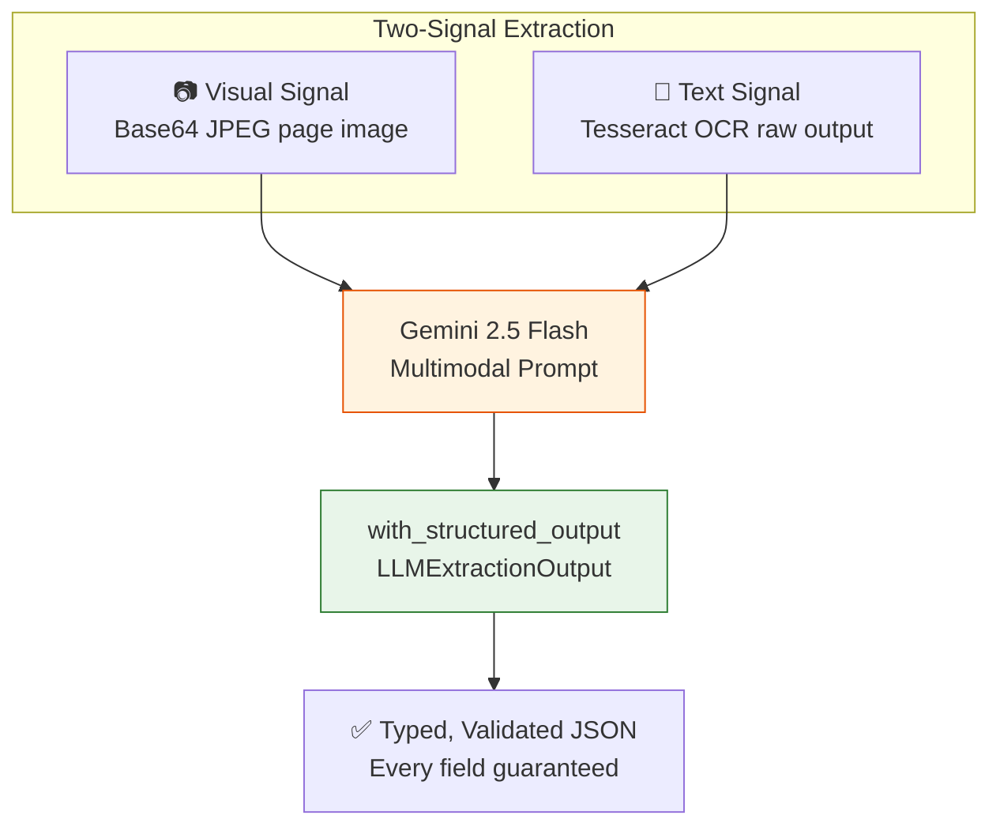
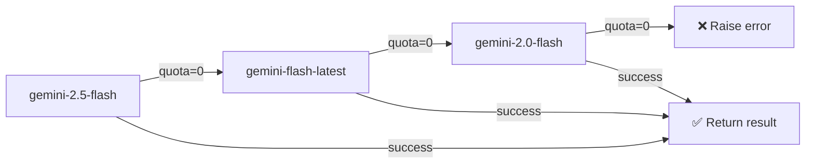
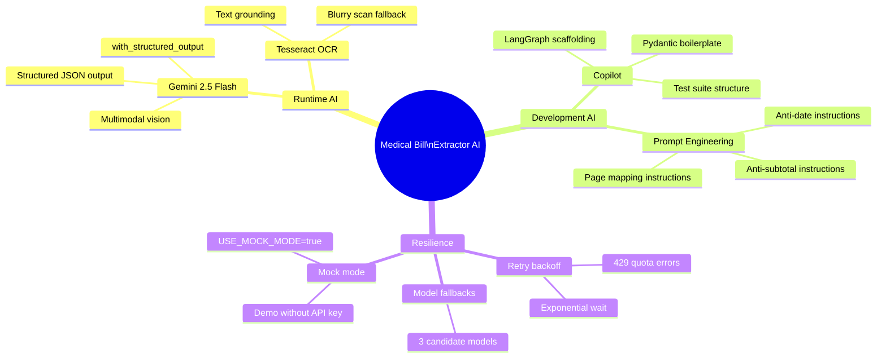

# AI Usage & Design Decisions

This page covers how AI was used both as a **development tool** and as the **core runtime engine**, plus the key design trade-offs made along the way.

---

## How AI Powers the Service at Runtime



The LLM does two things simultaneously:
1. **Reads the image** — uses vision to understand layout, tables, and formatting
2. **Cross-checks with OCR text** — validates visual understanding against raw extracted characters

This dual-signal approach means a blurry scan that Tesseract misreads can still be corrected by Gemini's visual understanding, and vice versa.

---

## How AI Was Used During Development

### 1. Structured Output Enforcement

The single most impactful AI technique used in this project:

```python
llm = ChatGoogleGenerativeAI(model="gemini-2.5-flash", ...) \
      .with_structured_output(LLMExtractionOutput)
```

`with_structured_output` tells LangChain to instruct the model to return JSON that strictly matches the `LLMExtractionOutput` Pydantic schema. The model never returns free-form text — it always returns a typed Python object.

**Why this matters:** Early prototypes parsed raw LLM text output with regex and `json.loads()`. This was brittle — the model occasionally added markdown code fences, explanatory text, or slightly wrong key names. `with_structured_output` eliminated all of those failure modes.

### 2. Prompt Engineering Iterations

The extraction prompt went through multiple iterations. Key lessons:

| Problem Observed | Fix Added to Prompt |
|-----------------|---------------------|
| Date values like `04/02/26` extracted as amounts | `"Do NOT confuse IDs/Dates with monetary amounts"` |
| Subtotal and GST lines included as items | `"Do NOT extract Sub-total, Total, Tax, or Discount lines"` |
| Items placed on wrong page | `"The input images correspond to pages 1, 2, 3... in order"` |
| Model ignoring OCR text | `"Use OCR Context to validate your visual understanding"` |
| Non-charge entries (hospital name, date) extracted | `"Extract all purchasable items... such that their sum equals the Final Bill Total"` |

### 3. OCR as a Grounding Signal

Rather than choosing between OCR and LLM vision, both are used together:

```python
if ocr_context:
    prompt = base_prompt + f"\n\n=== RAW OCR TEXT CONTEXT ===\n{ocr_context}"
```

The OCR text is appended to the prompt as a secondary signal. When OCR and vision agree, confidence is high. When they disagree, Gemini typically picks the clearer one — a useful form of automatic error correction.

### 4. Scaffolding with Copilot

During development, GitHub Copilot was used to:
- Scaffold the initial **LangGraph state machine** structure
- Generate boilerplate **Pydantic model definitions**
- Draft the **pytest test suite** structure

The retry/backoff logic, image preprocessing parameters, and prompt clauses were hand-tuned based on observed failures during testing.

---

## Design Decisions & Trade-offs

### Decision 1: LangGraph vs. Plain Functions

| Option | Pros | Cons |
|--------|------|------|
| **LangGraph state machine** ✅ | Explicit step visibility, easy to insert/reorder nodes, typed state | Slight overhead, learning curve |
| Plain async functions | Simpler code | Harder to observe, retry, or modify individual steps |

**Chose LangGraph** because competition debugging required knowing exactly _which step_ failed. LangGraph's node-based model made it easy to add logging and retry at each stage independently.

---

### Decision 2: Hybrid OCR + Vision vs. Vision Only

| Option | Accuracy on Clear Bills | Accuracy on Blurry Scans | API Cost |
|--------|------------------------|--------------------------|----------|
| **Hybrid OCR + Vision** ✅ | High | Higher | Slightly higher token count |
| Vision only | High | Medium | Lower |
| OCR only | Low (layout-sensitive) | Low | Near zero |

**Chose Hybrid** because the datathon dataset included low-quality scanned bills where vision alone struggled with small numbers.

---

### Decision 3: Batch Size = 2 Pages per API Call

| Batch Size | Reliability | Latency | Token Usage |
|------------|-------------|---------|-------------|
| 1 | Highest (smallest payload) | Slowest (most calls) | Lowest per call |
| **2** ✅ | Good | Balanced | Moderate |
| 4+ | Risk of hitting token limit | Fastest | Highest per call |

**Chose 2** as the default, configurable via `BATCH_SIZE` env var. This keeps each call well within Gemini's context window while halving API calls vs. single-page mode.

---

### Decision 4: Model Fallback List

The datathon used free-tier API quotas. A single model would hit `429 Quota Exceeded` mid-run and fail. The solution:

```
Primary:    gemini-2.5-flash
Fallback 1: gemini-flash-latest
Fallback 2: gemini-2.0-flash
```



---

### Decision 5: Magic-Byte PDF Detection

File servers sometimes return `application/octet-stream` for PDF files. Relying solely on the `Content-Type` header would cause the pipeline to fail. The fix:

```python
if file_data[:4] == b'%PDF':
    mime_type = 'application/pdf'
```

**Trade-off:** This only works for PDFs. For other formats, the declared MIME type is trusted. A more robust solution would use `python-magic` for full format detection, but this was sufficient for the datathon's input set.

---

### Decision 6: `safe_float()` for All Numeric Fields

LLMs occasionally return amounts as formatted strings like `"1,234.56"` or `null`. Rather than crashing on type coercion:

```python
def safe_float(value) -> float:
    try:
        return float(str(value).replace(",", "").strip())
    except (ValueError, TypeError):
        return 0.0
```

This makes the response layer completely resilient to model formatting quirks.

---

## Summary: AI Decision Map


