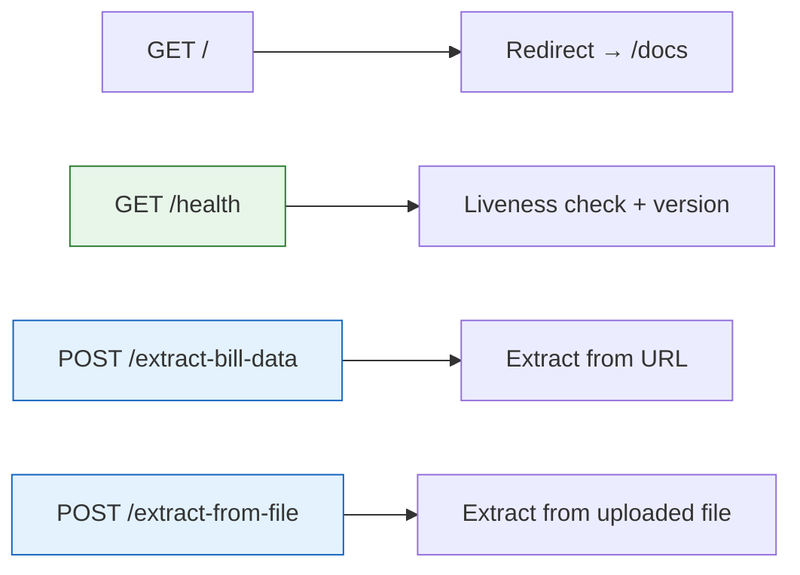
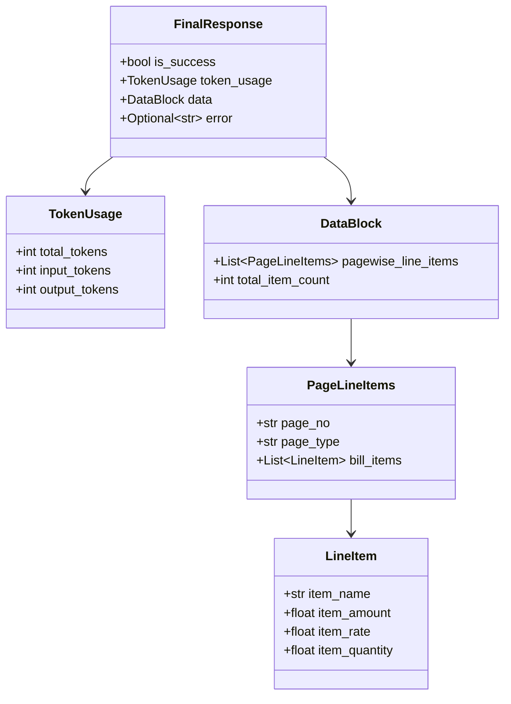

# API Reference

Complete reference for all endpoints in the Medical Bill Extractor service.

**Base URL (local):** `http://127.0.0.1:8000`  
**Swagger UI:** `http://127.0.0.1:8000/docs`  
**ReDoc:** `http://127.0.0.1:8000/redoc`

---

## Endpoints Overview



---

## GET /health

Liveness and version check. Use this to confirm the service is running before sending extraction requests.

**Request:**
```bash
curl http://127.0.0.1:8000/health
```

**Response `200 OK`:**
```json
{
  "status": "healthy",
  "version": "1.1.0"
}
```

---

## POST /extract-bill-data

Extract structured line items from a bill document at a publicly accessible URL.

**Request:**
```bash
curl -X POST http://127.0.0.1:8000/extract-bill-data \
  -H "Content-Type: application/json" \
  -d '{"document": "https://example.com/invoice.pdf"}'
```

**Request Body Schema:**
```json
{
  "document": "string (required)"
}
```

**Validation rules:**
- Scheme must be `http` or `https` (rejects `ftp://`, `file://`, etc.)
- Host must be present (`https://` alone is rejected)
- Leading/trailing whitespace is stripped automatically
- Maximum downloaded file size: **20 MB**

**Supported file types:** PDF, JPEG, PNG, WebP, and any image MIME type.

---

## POST /extract-from-file

Extract structured line items from a directly uploaded file.

**Request:**
```bash
curl -X POST http://127.0.0.1:8000/extract-from-file \
  -F "file=@/path/to/medical_bill.pdf"
```

**Form field:** `file` (multipart/form-data, required)

**Constraints:**
- Maximum file size: **20 MB** (returns HTTP 413 if exceeded)
- MIME type is read from the upload header; magic-byte detection overrides incorrect headers

---

## Response Schema

Both extraction endpoints return the same response shape.

### Success Response

```json
{
  "is_success": true,
  "token_usage": {
    "total_tokens": 0,
    "input_tokens": 0,
    "output_tokens": 0
  },
  "data": {
    "pagewise_line_items": [
      {
        "page_no": "1",
        "page_type": "Bill Detail",
        "bill_items": [
          {
            "item_name": "Medical Consultation",
            "item_amount": 500.00,
            "item_rate": 500.00,
            "item_quantity": 1.0
          },
          {
            "item_name": "Lab Tests - CBC",
            "item_amount": 1200.00,
            "item_rate": 600.00,
            "item_quantity": 2.0
          }
        ]
      }
    ],
    "total_item_count": 2
  },
  "error": null
}
```

### Failure Response

```json
{
  "is_success": false,
  "token_usage": {
    "total_tokens": 0,
    "input_tokens": 0,
    "output_tokens": 0
  },
  "data": {
    "pagewise_line_items": [],
    "total_item_count": 0
  },
  "error": "Description of what went wrong"
}
```

---

## Response Fields Reference

### Top-level fields

| Field | Type | Description |
|-------|------|-------------|
| `is_success` | `boolean` | `true` if extraction completed without error |
| `token_usage` | `object` | Token counts (always zeros — reserved for future billing integration) |
| `data` | `object` | Extracted bill data |
| `error` | `string \| null` | Error message when `is_success` is `false` |

### `data` object

| Field | Type | Description |
|-------|------|-------------|
| `pagewise_line_items` | `array` | One entry per page of the document |
| `total_item_count` | `integer` | Total number of bill items across all pages |

### `pagewise_line_items[]` entry

| Field | Type | Description |
|-------|------|-------------|
| `page_no` | `string` | Page number (1-indexed, as string) |
| `page_type` | `string` | Always `"Bill Detail"` |
| `bill_items` | `array` | Line items extracted from this page |

### `bill_items[]` entry

| Field | Type | Description |
|-------|------|-------------|
| `item_name` | `string` | Name of the service, medication, or procedure |
| `item_amount` | `float` | Total charge for this line item |
| `item_rate` | `float` | Unit price / rate |
| `item_quantity` | `float` | Quantity or units |

---

## HTTP Status Codes

| Code | Meaning |
|------|---------|
| `200` | Success or handled error (check `is_success` field) |
| `413` | File too large (> 20 MB on `/extract-from-file`) |
| `422` | Request validation failed (invalid URL scheme, missing fields, etc.) |
| `500` | Unhandled server error |

---

## Pydantic Schema Diagram



---

## CORS

The service allows cross-origin requests from any origin (`*`), all methods, and all headers. This makes it easy to call from browser-based frontends during development.
