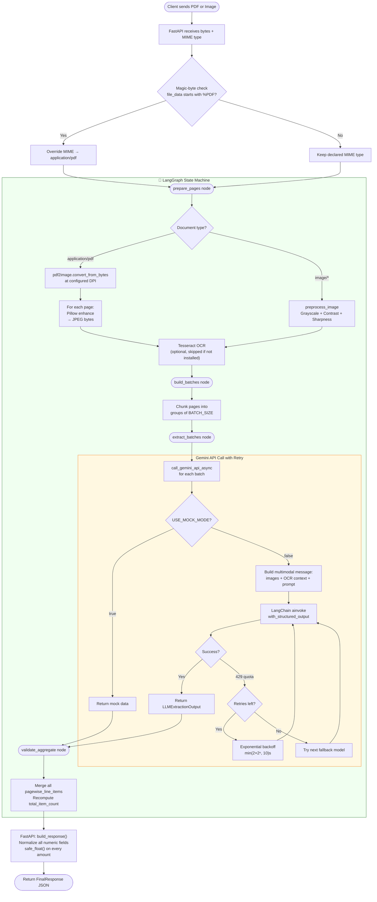
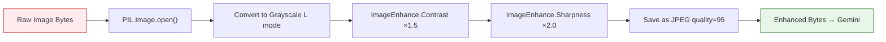
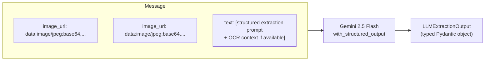
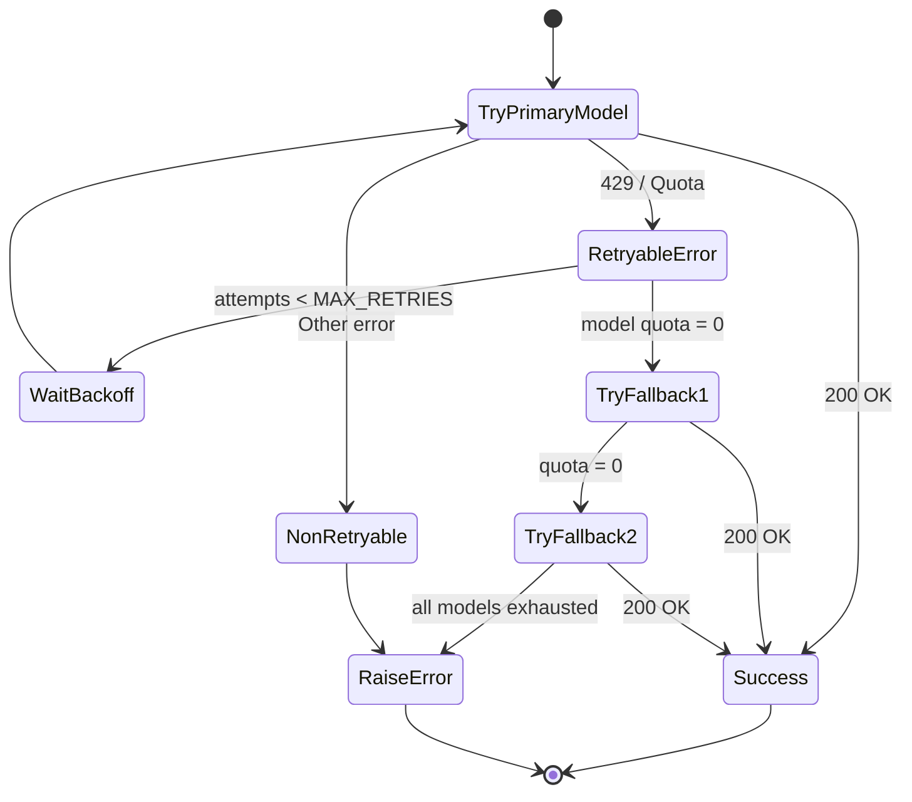

# Extraction Pipeline — Deep Dive

This page walks through every step a document takes from the moment it arrives at the API to the moment a structured JSON is returned.

---

## Full Pipeline Flowchart



---

## Step 1 — Input Normalization

**File:** `app/extractor.py` → `extract_bill_data()`

Before the pipeline starts, two normalizations happen:

1. **MIME stripping** — `"application/pdf; charset=utf-8"` becomes `"application/pdf"`
2. **Magic-byte detection** — if the first 4 bytes of the file are `%PDF`, the MIME is overridden to `application/pdf` regardless of what the server header claimed. This handles the common case where a file server returns `application/octet-stream`.

```
file_data[:4] == b'%PDF'  →  force mime_type = 'application/pdf'
```

---

## Step 2 — prepare_pages (LangGraph Node)

**File:** `app/extractor.py` → `_prepare_pages_node()`

### For PDFs:
1. `pdf2image.convert_from_bytes(file_data, dpi=PDF_DPI)` — each page becomes a Pillow image at `PDF_DPI` (default 200 DPI)
2. Each page image is enhanced with `preprocess_image()` and saved as JPEG at 95% quality
3. Tesseract OCR runs on each page (skipped gracefully if not installed)
4. Output: a list of `{page_no, media_payload, ocr_context}` dicts

### For images:
1. `preprocess_image()` applies three Pillow transforms:
   - Convert to **grayscale** (removes colour noise)
   - **Contrast** × 1.5 (makes text stand out)
   - **Sharpness** × 2.0 (sharpens blurry edges)
2. Tesseract OCR runs on the enhanced image

### Image Preprocessing Pipeline



---

## Step 3 — build_batches (LangGraph Node)

**File:** `app/extractor.py` → `_build_batches_node()`

Pages are grouped into batches of `BATCH_SIZE` (default: 2). This controls how many page images go into a single Gemini API call.

```
Pages:   [P1, P2, P3, P4, P5]
BATCH_SIZE = 2
Batches: [[P1, P2], [P3, P4], [P5]]
```

**Why batch at all?** Each API call has a token limit. Batching 2 pages per call keeps the payload size safe while reducing total API round-trips versus one-page-per-call.

---

## Step 4 — extract_batches + Gemini API Call

**File:** `app/extractor.py` → `_extract_batches_node()` and `call_gemini_api_async()`

Each batch is sent to Gemini as a **multimodal message**:



### The Extraction Prompt (Key Clauses)

| Clause | Purpose |
|--------|---------|
| `"Extract all purchasable items"` | Focus on charges, not summaries |
| `"Do NOT extract Sub-total, Total, Tax, Discount"` | Prevent double-counting |
| `"Do NOT confuse IDs/Dates with monetary amounts"` | Eliminates date-as-price errors |
| `"The images correspond to pages 1, 2, 3… in order"` | Correct page assignment |
| `"Use OCR Context to validate your visual understanding"` | Cross-signal validation |

### Retry & Fallback Logic



Backoff formula: `wait = min(2 × 2ⁿ, 10)` seconds where `n` is the attempt index.

---

## Step 5 — validate_aggregate (LangGraph Node)

**File:** `app/extractor.py` → `_validate_and_aggregate_node()`

All batch results are merged:

1. Each batch's `pagewise_line_items` list is extended into a single flat list
2. `total_item_count` is **recomputed from scratch** by counting actual `bill_items` — the model's self-reported count is discarded and recalculated to guarantee accuracy

---

## Step 6 — Response Normalization

**File:** `app/main.py` → `build_response()`, `safe_float()`

Every field is defensively normalized before returning to the client:

| Field | Normalization |
|-------|--------------|
| `item_amount` | `safe_float()` — strips commas, handles `None`, falls back to `0.0` |
| `item_rate` | same |
| `item_quantity` | same |
| `item_name` | string coercion, empty string fallback |
| `page_no` | forced to `str` |
| `total_item_count` | recomputed from actual item count |

---

## LangGraph State Shape

The entire pipeline runs inside a single typed state object:

```python
class BillExtractionState(TypedDict, total=False):
    file_data: bytes          # Raw input bytes
    mime_type: str            # Normalized MIME type
    pages: list[dict]         # Output of prepare_pages
    batches: list[dict]       # Output of build_batches
    batch_results: list[dict] # Output of extract_batches
    result: dict              # Final aggregated output
```

Each node reads from state and returns only the keys it produces — LangGraph merges them automatically.
