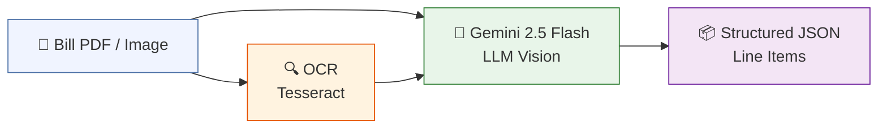

# 🏥 Medical Bill Extractor — Project Wiki

> **Bajaj Finserv Datathon · Rank 44**  
> A production-ready AI service that converts raw medical bill images and PDFs into clean, structured JSON.


---

## What This Project Does

Medical bills are messy — they come as scanned PDFs, phone photos, or low-quality images, and every hospital formats them differently. This service accepts any bill document (via URL or direct upload), runs it through a **hybrid OCR + LLM pipeline**, and returns perfectly structured JSON with every line item, quantity, rate, and amount extracted.

```
Input:  A medical bill PDF or image
Output: Structured JSON with every itemized charge
```

---

## Wiki Pages

| Page | What You'll Learn |
|------|-------------------|
| [System Architecture](./System-Architecture.md) | How all components connect — the big picture |
| [Extraction Pipeline](./Extraction-Pipeline.md) | Step-by-step walkthrough of how a document becomes JSON |
| [API Reference](./API-Reference.md) | All endpoints, request shapes, and response schemas |
| [AI & Design Decisions](./AI-Design-Decisions.md) | How AI was used to build and power the service, plus trade-offs |
| [Local Setup & Testing](./Local-Setup-and-Testing.md) | Running locally, environment config, and test suite |
| [Video Recording Script](./Video-Recording-Script.md) | Talking points for recording your Loom walkthrough |

---

## 30-Second Project Summary



**Core idea:** Use Tesseract OCR as a text safety-net, feed both the raw image _and_ the OCR text to Gemini, enforce a strict output schema via LangChain's `with_structured_output`, and wrap everything in a resilient LangGraph pipeline with fallback models.

---

## Repository Structure

```
medical-bill-extractor/
├── app/
│   ├── main.py          ← FastAPI routes, input validation, response normalization
│   ├── extractor.py     ← The entire AI pipeline (OCR, LangGraph, Gemini)
│   └── schemas.py       ← Pydantic response models
├── tests/
│   ├── test_api.py      ← Endpoint and validation tests
│   ├── test_unit.py     ← Utility and workflow behavior tests
│   └── test_models.py   ← Integration smoke tests for model access
├── docs/wiki/           ← This wiki
├── Dockerfile
├── render.yaml
└── requirements.txt
```

---

## Key Numbers

| Metric | Value |
|--------|-------|
| Datathon rank | **44 / ~500+** |
| API endpoints | 3 (health, URL extract, file upload) |
| Supported input types | PDF, JPEG, PNG, WebP |
| Max file size | 20 MB |
| LLM fallback models | 3 (primary + 2 fallbacks) |
| Max retries on quota error | 10 |
