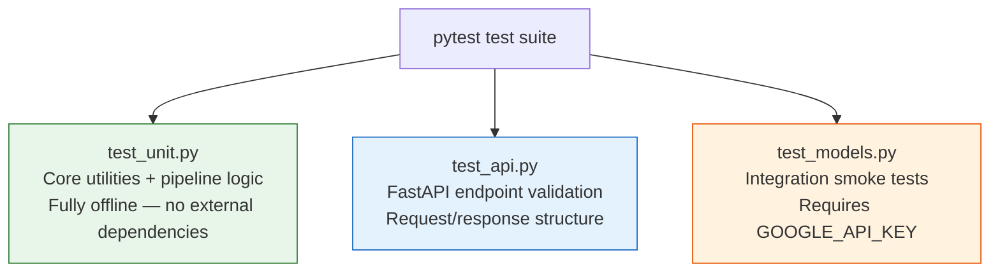

# Local Setup & Testing

This page covers everything you need to run the service locally, configure it, and run the test suite.

---

## Prerequisites

### System dependencies

```bash
# Ubuntu / Debian
sudo apt-get install -y poppler-utils tesseract-ocr

# macOS
brew install poppler tesseract

# Windows
# Install Poppler: https://github.com/oschwartz10612/poppler-windows/releases
# Install Tesseract: https://github.com/UB-Mannheim/tesseract/wiki
```

| Dependency | Used for |
|-----------|---------|
| `poppler-utils` | `pdf2image` uses poppler to convert PDF pages to images |
| `tesseract-ocr` | `pytesseract` uses Tesseract for optional OCR |

---

## Installation

```bash
# 1. Clone the repo
git clone https://github.com/nish0753/medical-bill-extractor.git
cd medical-bill-extractor

# 2. Create and activate a virtual environment (recommended)
python -m venv .venv
source .venv/bin/activate   # Windows: .venv\Scripts\activate

# 3. Install Python dependencies
pip install -r requirements.txt
```

---

## Environment Configuration

Create a `.env` file in the project root:

```env
# Required
GOOGLE_API_KEY=your_google_api_key_here

# Optional — these are the defaults
GEMINI_MODEL=gemini-2.5-flash
GEMINI_MODEL_FALLBACKS=gemini-flash-latest,gemini-2.0-flash
MAX_RETRIES=10
BATCH_SIZE=2
PDF_DPI=200
USE_MOCK_MODE=false
```

### Getting a Google API Key

1. Go to [https://aistudio.google.com/apikey](https://aistudio.google.com/apikey)
2. Create a new API key
3. Paste it as `GOOGLE_API_KEY` in your `.env`

### Demo mode (no API key needed)

Set `USE_MOCK_MODE=true` to return pre-canned sample data without making any Gemini API calls. Useful for UI demos or testing the API shape.

---

## Running the Service

```bash
python -m uvicorn app.main:app --host 127.0.0.1 --port 8000 --reload
```

| URL | Description |
|-----|-------------|
| `http://127.0.0.1:8000/docs` | Swagger UI — interactive API explorer |
| `http://127.0.0.1:8000/redoc` | ReDoc documentation |
| `http://127.0.0.1:8000/health` | Health check |

---

## Running with Docker

```bash
# Build the image
docker build -t medical-bill-extractor .

# Run the container
docker run -p 10000:10000 \
  -e GOOGLE_API_KEY=your_key_here \
  medical-bill-extractor
```

Service will be available at `http://localhost:10000`.

---

## Testing

### Test structure



### Run tests

```bash
# Fast — no external model dependency (recommended for local dev)
pytest -q -m "not integration"

# Full suite — requires GOOGLE_API_KEY
pytest -q

# Verbose output
pytest -v

# Specific file
pytest tests/test_unit.py -v
```

### What the tests cover

| Test file | What's tested |
|-----------|--------------|
| `test_unit.py` | `safe_float()` edge cases, `build_response()` normalization, `preprocess_image()`, LangGraph batch aggregation end-to-end (mocked), Gemini retry behavior (mocked) |
| `test_api.py` | URL scheme validation, missing fields, file too large, response structure, error responses, JSON validity |
| `test_models.py` | Live Gemini API smoke test (requires key) |

---

## Configuration Reference

| Variable | Default | Description |
|----------|---------|-------------|
| `GOOGLE_API_KEY` | _(required)_ | Google AI Studio API key |
| `GEMINI_MODEL` | `gemini-2.5-flash` | Primary LLM model |
| `GEMINI_MODEL_FALLBACKS` | `gemini-flash-latest,gemini-2.0-flash` | Comma-separated fallback models |
| `MAX_RETRIES` | `10` | Max retry attempts per model on quota errors |
| `BATCH_SIZE` | `2` | Pages per Gemini API call |
| `PDF_DPI` | `200` | DPI for PDF-to-image conversion (higher = better quality, slower) |
| `USE_MOCK_MODE` | `false` | Return mock data without real API calls |

---

## Deployment (Render)

The included `render.yaml` enables one-click deployment on [Render](https://render.com):

1. Push to GitHub
2. Connect the repo on Render
3. Set `GOOGLE_API_KEY` as an environment variable in the Render dashboard
4. Deploy — Render builds the Docker image and starts the service on port 10000
