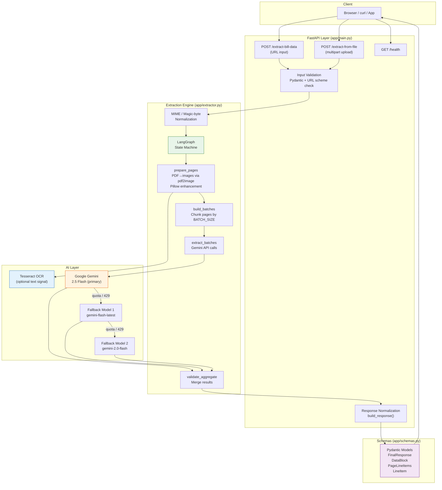
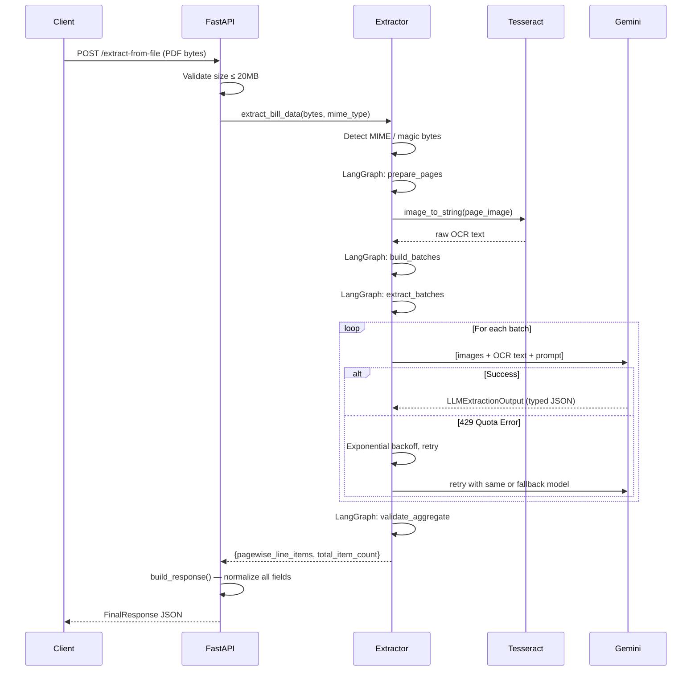

# System Architecture

This page explains how all parts of the Medical Bill Extractor fit together, from the client request down to the final JSON response.

---

## High-Level Component Map

---

## Layer Descriptions

### 1. FastAPI Layer (`app/main.py`)

The entry point. Responsible for:
- **URL input validation** — only `http://` and `https://` schemes accepted, host must be present
- **File size enforcement** — rejects uploads over 20 MB
- **Thread isolation** — synchronous I/O (download, OCR, PDF conversion) is dispatched to a thread-pool executor so the async event loop is never blocked
- **Response normalization** — `build_response()` applies `safe_float()` to every numeric field and coerces all values to the exact schema shape

### 2. Extraction Engine (`app/extractor.py`)

The brain. A **LangGraph state machine** with four sequential nodes:

| Node | Responsibility |
|------|----------------|
| `prepare_pages` | Converts PDFs to page images; applies Pillow grayscale + contrast + sharpness; runs optional OCR |
| `build_batches` | Chunks page list into groups of `BATCH_SIZE` (default 2) |
| `extract_batches` | Sends each batch to Gemini with a structured prompt |
| `validate_aggregate` | Merges all batch results; recomputes `total_item_count` |

### 3. AI Layer

Two parallel signals flow into Gemini:
1. **Visual signal** — base64-encoded JPEG of each page
2. **Text signal** — raw OCR output from Tesseract (when available)

Gemini uses `with_structured_output(LLMExtractionOutput)` via LangChain, which means it _always_ returns typed, validated data — never free-form text.

### 4. Schemas (`app/schemas.py`)

Pure Pydantic models that define the wire format. Nothing is typed as `Any` in the public response — every field is explicit.

---

## Request Lifecycle (Sequence Diagram)

---

## Technology Map

| Layer | Technology | Why |
|-------|-----------|-----|
| API | FastAPI + Pydantic | Async, type-safe, auto-generates Swagger docs |
| Orchestration | LangGraph | Typed state machine — easy to add/reorder steps |
| LLM integration | LangChain + ChatGoogleGenerativeAI | `with_structured_output` eliminates JSON parsing errors |
| LLM | Google Gemini 2.5 Flash | Best accuracy/speed/cost ratio for multimodal extraction |
| PDF handling | pdf2image (poppler) | Reliable PDF-to-image conversion at configurable DPI |
| Image enhancement | Pillow | Grayscale + contrast + sharpness boost before OCR |
| OCR | pytesseract (Tesseract) | Free text signal to help the LLM with blurry scans |
| Deployment | Docker + Render | `render.yaml` enables one-click cloud deployment |
| Testing | pytest | Unit, API, and integration test layers |
